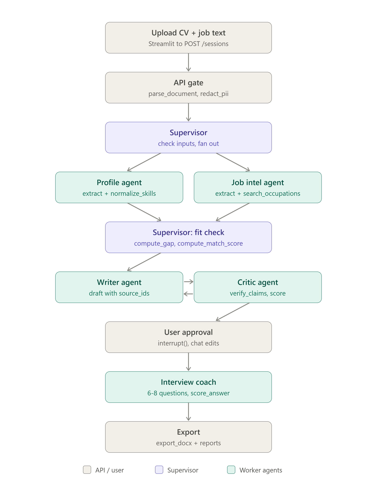

# CareerCrew — Multi-Agent Job Application Assistant

> Six AI agents that tailor your CV to any job, and refuse to lie for you.

CareerCrew takes a CV and a job description, tailors the CV to the job **without inventing anything**,
explains the skill gap, and runs a mock interview for that exact job. Six LLM-powered agents work as one
team, coordinated by **LangGraph**. DEPI graduation project — 6 members, 1 agent each.

The full design is in [`CareerCrew — Multi-Agent Job Application Assistant (Project Spec).docx`](<CareerCrew — Multi-Agent Job Application Assistant (Project Spec).docx>).



## The agents

| # | Agent | Job | Owner |
|---|---|---|---|
| 1 | Supervisor | checks the inputs and decides which agent runs next | Member 1 |
| 2 | Profile | CV file → structured candidate profile | Member 2 |
| 3 | Job Intelligence | job post → requirements + gap report | Member 3 |
| 4 | Resume Writer | tailored CV, every bullet linked to its source | Member 4 |
| 5 | Critic | fact-checks the draft and computes the Match Score | Member 5 |
| 6 | Interview Coach | job-specific mock interview with scored feedback | Member 6 |

## Status

Work in progress. Done so far:
- `tools/document_parser.py`: reads a PDF CV and a `.txt` job post
- **Shared contracts**: `schemas/` (one file per agent output) and `graph/state.py`
- **Supervisor agent** (`agents/supervisor/`): checks, phase, router, actions, `ask_user` pause
- **Graph** (`graph/`): every agent linked through the Supervisor, `fit_check`, fake/real switch
- **Fake agents** (`agents/fakes.py`): a full session runs from start to end before the real agents exist
- **Tests**: 72 tests, including one full session per scenario

## How the agents are linked

Every agent is a function `run(state) -> dict` that returns only the state keys it owns.
After every agent the graph returns to the Supervisor, which decides the next step.
Agents never import each other. See `agents/supervisor/README.md` for the decision table.

**To plug in your real agent:** create `agents/<name>/agent.py` with `run(state) -> dict`,
make it pass the same tests as its fake, then change `fake` to `real` for it in `configs/agents.yaml`.

## Setup

Requires Python 3.10 or newer.

```bash
python -m venv venv
venv\Scriptsctivate            # Mac/Linux: source venv/bin/activate
pip install -r requirements.txt
copy .env.example .env           # Mac/Linux: cp .env.example .env
```

Then open `.env` and paste your free Groq API key (from https://console.groq.com/keys).
Never commit `.env`.

## Run

From the project root:

```bash
python -m pytest                                         # all tests
python -m scripts.run_session                            # one full session with fake agents
python -m scripts.run_session --scenario critic_rejects_always
python -m agents.supervisor.checks path/to/cv.pdf path/to/job.txt
```

Scenarios: `happy`, `not_a_job`, `unclear_cv`, `low_fit`, `critic_rejects_once`, `critic_rejects_always`.

## Project structure

`[SHARED]` = everyone depends on it: change it only with the team's approval.

```
schemas/              [SHARED] the contracts: profile, job, resume, critique, interview, routing
graph/
  state.py            [SHARED] GraphState: every key and its owner
  validate.py         [SHARED] require(): input checks that raise clear errors
  registry.py         fake or real agent, from configs/agents.yaml
  builder.py          builds the LangGraph graph
  fit_check.py        gap report + fit score (temporary simple version)
  session.py          start a session, answer a question, read the state
agents/
  fakes.py            fake versions of the 5 worker agents
  supervisor/         Member 1: agent, checks, phase, router, actions
  profile/ job_intel/ writer/ critic/ interview/   Members 2 to 6 (to do)
tools/                [SHARED] document_parser.py (more tools to come)
configs/              [SHARED] agents.yaml, supervisor.yaml
config.py             [SHARED] load_yaml(), ROOT
scripts/              run_session.py
tests/
  fixtures/           [SHARED] one sample JSON per schema
  helpers.py          builds test states from the fixtures
data/samples/         [SHARED] synthetic CV + job post
api/  ui/  evaluation/   empty for now
```

## Data rules

- **No real CV or personal data in Git** (spec section 7.4). Use the synthetic samples in `data/samples/`.
- Keep real CVs in `data/private/` on your machine. That folder is git-ignored.
- `.env`, `data/raw/` and processed Parquet files are git-ignored.
- Notebooks and quick experiments go in `scratch/`, which is git-ignored.
